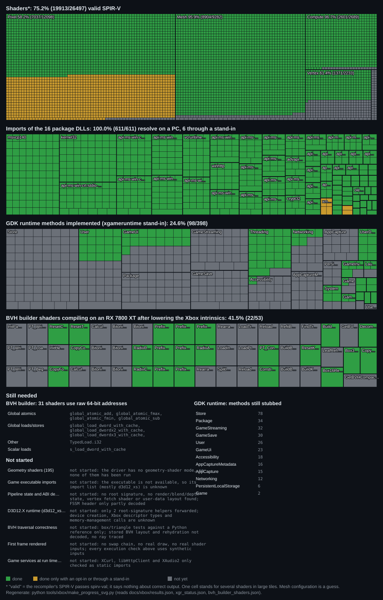

# americas-recomp

An experiment: can the RDNA2 shaders from an Xbox Series game go through [AnyPS5](https://github.com/boykopovar/AnyPS5)'s shader recompiler (the Series X GPU shares the PS5's RDNA2 ISA)? This is a local fork on branch `xbox-series`. The shaders come from the author's own console dump.

"Valid" below means the recompiler produced SPIR-V that passes `spirv-val` (Vulkan SDK 1.4.363.1, `--target-env vulkan1.3`). It does not mean the output is correct. Separately, a subset of shaders has been **executed** on a GPU and compared bit for bit with an independent CPU interpreter: 242 compute shaders (up to 1500 bytes) and 157 of the 738 pixel shaders match; the pixel run found none that differ, the compute run found a recompiler bug (fixed) and 1 remaining difference of a few ulp that a 1-ulp hardware reciprocal explains (five former mismatches read workgroup memory nothing wrote, so they are now skipped as not comparable). The pixel check uses one constant input vector, so it says little about interpolation. Details and limits: `docs/xbox/XBOX_SHADERS.md`.

## Progress

Regenerate with `python tools/xbox/make_progress_svg.py` (reads `docs/xbox/results.json`).

The last row is the platform surface of the 16 DLLs shipped with the package (static imports only, see `docs/xbox/PLATFORM_SURFACE.md`): 605 of 611 imported functions resolve on a PC as they are; the 6 that do not belong to two Xbox-only libraries (`xmem.dll`, `d3d12_xs.dll`). Stand-ins for both are in `tools/xbox/platform/`; all six DLLs that import something load on a PC with them, and the game's Bink decoder decodes a real video through the `xmem.dll` stand-in. The grey rows below it are work that has not started and cannot be measured yet (game executable imports, pipeline state and ABI decode, the d3d12_xs runtime, BVH traversal correctness, a first rendered frame, game services at run time); the green platform row only covers the DLLs' static imports, so it is not a completion figure.

Corpus: `shaders.rpf` holds 26,503 shaders: 24,804 in the main entry run plus 1,699 in a second run further on that my first scan missed (found by comparing with the shader count of the Leonida project, https://github.com/ItsNotRexed/Leonida). 26,497 of them were run through the recompiler (6 of the second run do not inflate). The first results covered a 4,147-shader sample; everything below is now the whole corpus.

| Stage | Shaders | Valid SPIR-V | Notes |
|---|---|---|---|
| Compute | 2,689 | **2,601 (96.7%)** | union of four fake-memory variants, longer limit for the slow ones; 0 invalid |
| Pixel | 12,098 | **7,037 (58.2%, strict)** | 7,271 if the host has `VK_KHR_fragment_shader_barycentric`; 11,993 (99.1%) with that and the f16 approximation (below) |
| Vertex | 2,233 | 1,371 (61.4%) | the rest mostly need the real vertex fetch shader |
| Mesh | 9,282 | 8,035 (86.6%) | mesh configuration is a guess |
| Geometry | 195 | not run | no driver mode for geometry shaders |

All SPIR-V that was produced validates (0 invalid). "Valid" is `spirv-val` only; the execution checks cover a small subset (docs/xbox/XBOX_SHADERS.md). Pixel shaders use harness defaults for everything the executable will decide (formats, blend, depth, export mapping).

### What changed in the recompiler
- **Bindless waterfall loops:** `v_readfirstlane` + `v_cmpx` loops that load descriptors from a heap pointer are now resolved (phi-aware exec-mask check in `SrtInstructionPredicates.cpp`, table-column handling in `ResourceTracker.cpp`).
- **Structurizer speedup:** faster dominance and a split budget, with an identical graph hash on 4,119 shaders.
- **Xbox ISA tweaks and MSVC build fixes.**
- **Header decoder:** `tools/xbox/fssm_header.py` decodes the section directory and pixel input table of the shader container. It agrees with what the code already gives, so it adds no new information.

### Assumptions (not verified on hardware)
1. A lane-active select arm in waterfall loops is assumed active (`XBOX_NO_LANE_ASSUME` turns it off).
2. Descriptor heap entries are assumed to be size-aligned (`XBOX_NO_OPAQUE_HEAP_INDEX` turns it off).
3. Opt-in only: 16-bit interpolation ignores fp16 rounding bits (`XBOX_ALLOW_UNMEASURED_F16_INTERP`). Xbox pixel shaders set round-toward-zero, so results may differ in the last bit. It is off by default, which is why the strict figure is the headline.

Float mode, export mapping, mesh configuration and descriptor contents are harness defaults, not read from the game.

### Why the full corpus fails (counts are shaders)
- **Pixel, strict:** most failures read a 16-bit interpolant, which is refused unless the f16 approximation is on (Xbox sets round-toward-zero and the recompiler has no measured model for it). With every opt-in 105 still fail: descriptor and sampler chains, 15 over the barycentric location limit, 14 sampling with clamps the emitter rejects. (952 more failed on atomic image formats in the first full run; that was the harness again: the new shaders' bindings had been made with an old copy of `bindings.py` that does not mark atomic images. Regenerated, 949 of them pass.)
- **Vertex (862):** 562 computed `s_swappc` targets and 223 fetch-shader calls with no parsed plan: vertex input layout comes from the pipeline state, so these wait for the executable.
- **Mesh (1,247):** 996 descriptor sources read through a null pointer (likely a harness gap, user data is not real), plus sampler and image chains.
- **Compute (88):** see below.

The next list describes the first 4,147-shader sample and is kept for the details.

### Remaining failures (first sample)
- Compute (88): about 82 descriptor chains (descriptors reached through a runtime index loaded from a buffer, or through address-loaded pointers), 3 timeouts, 2 64-bit image atomics under other memory variants, 1 phi-dominance case.
- Pixel (3 with all opt-ins): descriptor and sampler chains.
- Vertex (22): 12 computed `s_swappc` targets and 4 dynamic `s_setpc` that need the real vertex fetch shader / vertex input layout, 2 fetch calls with no fetch-shader plan, descriptor chains.
- Mesh (81): 66 descriptor sources read through a null pointer (likely a harness gap), descriptor and sampler chains, 1 timeout.

### What changed since the first pass
- **Atomic image failures were a harness gap:** atomic image ops need 32-bit (or, for 64-bit atomics, 32_32) formats, but the fake descriptors used an 8-bit format. The binding analysis now marks atomic images and the driver builds matching descriptors. Compute 16 of 16 and pixel 20 more now pass.
- **Barycentric limit:** the 30 pixel shaders over the 32-location limit pass when the host has `VK_KHR_fragment_shader_barycentric` (no emulation). Reported separately, not folded into the strict number.
- **Timeouts were mostly my limit:** 78 of 81 passed given up to 616 s; the slow ones are a structurizer cost problem, not a hang.
- **Phi dominance errors:** a pre-existing structurizer bug (the original upstream structurizer fails the same way). `Recompile` now retries once with the flag-based structurizer when it sees that error.
- **`s_swappc sN, sN`:** the call's own link write no longer makes the fetch-call target look computed.

### Ray tracing and BVH
- 62 of 64 compute shaders that use the hardware BVH instruction recompile and pass `spirv-val` (7 of them only with a 15 minute limit). Nothing was traversed.
- The 8.3 GB BVH dump holds 1,260 nested archives of compressed BVHs. The builder's rehydration shaders rebuild the box nodes and rebuild the triangle leaves from the game's own vertex and index buffers, so the files hold topology and indices, not vertex positions. The bit layout is not decoded. See [`docs/xbox/BVH_CONTAINER.md`](docs/xbox/BVH_CONTAINER.md).

### Where to look
- [`docs/xbox/XBOX_SHADERS.md`](docs/xbox/XBOX_SHADERS.md): full write-up, with the harness defaults.
- [`tools/xbox`](tools/xbox): driver, runners, binding analysis, header decoder.

Not included in this repo: the shader dumps and any game files.

## Mention: AnyPS5

This is a fork of [AnyPS5](https://github.com/boykopovar/AnyPS5) (GPL-2.0). The original README is below.

AnyPS5 README (original, unmodified)

**English** | [Português (Brasil)](docs/user/README.pt-BR.md) | [Español](docs/user/README.es.md) | [Català](docs/user/README.ca.md) | [Italiano](docs/user/README.it.md) | [简体中文](docs/user/README.zh-CN.md) | [Русский](docs/user/README.ru.md) | [Bahasa Indonesia](docs/user/README.id.md) | [Polski](docs/user/README.pl.md) | [日本語](docs/user/README.ja.md) | [العربية](docs/user/README.ar.md)

# About

Tool for automatic executables porting to Linux and Windows.

The relinker-only build runs on macOS, including Apple silicon.

[**Web converter**](https://boykopovar.github.io/AnyPS5/) - files stay on your device.

Includes a [relinker](core/relinker) that converts executable to the target system's native format and implementations of [system prx libraries](core/libs/prx) suitable for dynamic linking. No emulation or separate runtime process.

[**Discord**](https://discord.gg/x9naWVzC6A), [Usage](docs/user/USAGE.md), [Build instructions](docs/dev/BUILD.md), [Architecture](docs/dev/ARCHITECTURE.md), [Technical debt of the project](docs/dev/TechnicalDebt.md), [code style conventions](docs/dev/CONVENTIONS.md), [contributing](CONTRIBUTING.md)

## Status

   

[Progress history](https://boykopovar.github.io/AnyPS5/history.html)

* System libraries: percentage of the functions known to the project so far (declared in [core/libs/prx](core/libs/prx)), not of every PS5 system function. The total grows as more functions are declared.

Unsupported or unexpected states throw a C++ exception, usually `std::runtime_error`. An exception that nothing catches prints its `what()` to stderr and ends the process.

The [shader recompiler](core/shader/recompiler/Recompiler.cpp) successfully produces SPIR-V (validated via [Spirv-Tools](3rdparty/SPIRV-Tools) when built with `ANYPS5_ENABLE_SPIRV_TOOLS`).

## Compatibility

Per-game status and test reports live in the [Game bring-up](https://github.com/boykopovar/AnyPS5/discussions/categories/game-bring-up) discussions, one thread per title.

## Input mapping

SDL-mapped game controllers are supported, including analog sticks and triggers. Keyboard and mouse controls can be configured with an `anyps5-input.ini` file. See [input mapping](docs/user/INPUT_MAPPING.md) for the supported devices and configuration format.

## Disclaimer

This project is intended for interoperability, research, preservation, and compatibility purposes. It does not include, distribute, or require copyrighted software, firmware, cryptographic keys, or proprietary libraries. Users are responsible for ensuring that any binaries used with this project are obtained and used in accordance with applicable laws and their respective license terms.

AnyPS5 is an independent project and is not affiliated with, authorized or endorsed by Sony Interactive Entertainment. "PlayStation" and "PS5" are trademarks of Sony Interactive Entertainment Inc.

## License

This project is licensed under the GNU General Public License version 2 only.

